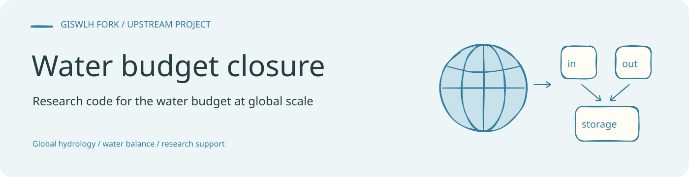
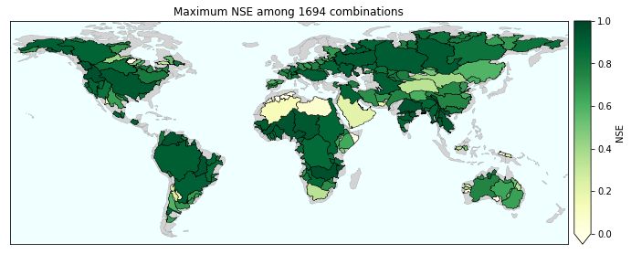

<!-- readme-visual-refresh:banner -->

<!-- /readme-visual-refresh:banner -->

# How well are we able to close the water budget on a global scale?
This code comes in support of the article written by Fanny Lehmann, Bramha Dutt Vishkawarma, and Jonathan Bamber (School of Geographical Sciences, University of Bristol, United Kingdom). 

All figures in the article can be reproduced by using this code with Jupyter notebooks. The main files to do so are [NSE maps](https://github.com/lehmannfa/water_budget_closure/blob/main/NSE%20maps.ipynb) and [Hierarchical clustering](https://github.com/lehmannfa/water_budget_closure/blob/main/Hierarchical%20clustering%20of%20basins.ipynb).

# Reference
please refer this:  
Lehmann, F., Vishwakarma, B. D., & Bamber, J. (2022). How well are we able to close the water budget at the global scale?. Hydrology and earth system sciences, 26(1), 35-54. https://doi.org/10.5194/hess-26-35-2022

<!-- readme-visual-refresh:artwork-source -->
[Editable banner artwork · Excalidraw](assets/readme/banner.excalidraw)
<!-- /readme-visual-refresh:artwork-source -->

<!-- readme-visual-refresh:selected-result -->

## 已有结果展示

原 Notebook 保存的流域地图，展示 1694 种水量平衡组合中的最大 NSE。 该图为仓库已有上游示例，保留原有来源；本次仅整理展示，未重新运行。 [查看来源](https://github.com/GISWLH/water_budget_closure/blob/main/NSE%20maps.ipynb)。

<!-- /readme-visual-refresh:selected-result -->
